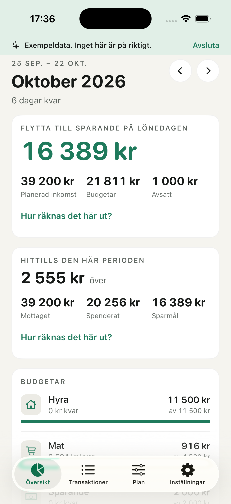
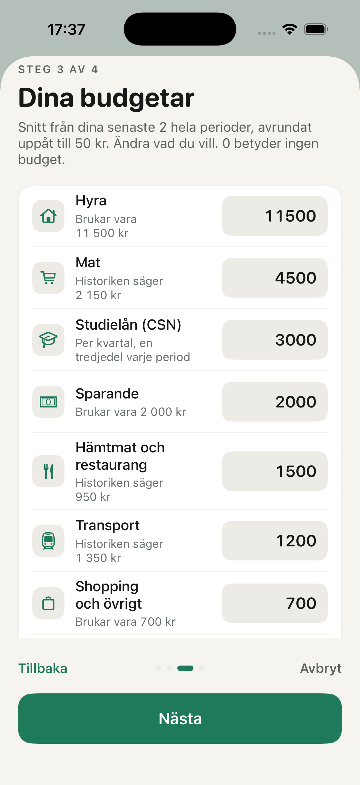
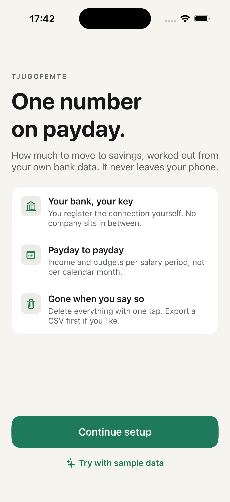
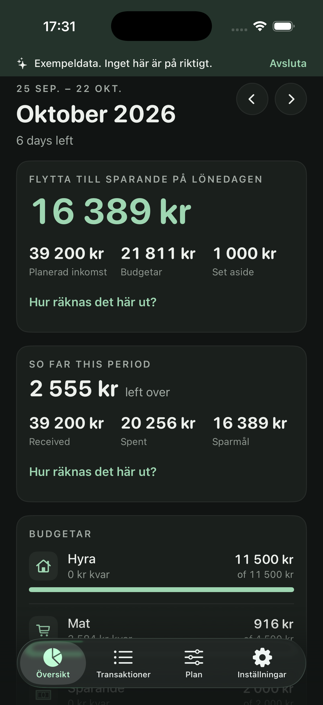

# Tjugofemte

Personal budgeting for iPhone, built around one number: what to move to savings on payday (the 25th, hence the name). Transactions come straight from your bank through [Enable Banking](https://enablebanking.com), using a connection you register yourself. There is no server, no account and no analytics. The app itself talks only to `api.enablebanking.com`.

Swedish and English. Free and open source.

| | |
|---|---|
|  |  |
|  |  |

## How it works

1. The app generates an RSA-4096 key inside the phone's Keychain and shows you the public half.
2. You register a free application in Enable Banking's control panel, paste the public key, and paste the Application ID back into the app. You activate the application by linking your own accounts. Enable Banking's terms allow exactly this: production use "for the personal use of private individuals".
3. The app opens the system browser for the bank's BankID login, receives a one-time code, exchanges it for a session and fetches booked transactions.
4. The app asks how much history to keep, then walks you through six screens built from the transactions it just fetched: payday and income (guessed, you confirm), sorting the biggest merchants no rule recognized, a look at your own money (savings rate, needs against wants, recurring charges, biggest wants), a savings goal that the budgets follow from, and a summary with one number at the end. The Goal screen opens again from the Plan tab at any time.
5. Transactions are categorized with keyword rules you can edit, and compared against the plan: income sources and budgets per payday period.

The savings target is a plan number, fixed when the period starts: planned income minus every budget. "Left over so far" is income received minus spending minus that target. Every derived number has a "how is this calculated" line on screen.

## Setup

Requirements: Xcode 26, [XcodeGen](https://github.com/yonaskolb/XcodeGen) (`brew install xcodegen`), an iPhone running iOS 18 or later. No secrets, API keys or `.pem` files are needed in the repository, ever.

```bash
xcodegen generate
open Tjugofemte.xcodeproj
```

Change `DEVELOPMENT_TEAM` in `project.yml` to your own team before generating. Run the `Tjugofemte` scheme on a simulator or your phone. The `-demo` launch argument opens straight into sample data.

Fast test loop, per package:

```bash
cd Packages/BudgetCore && swift test
cd Packages/EnableBankingKit && swift test
cd Packages/LocalStore && swift test
```

Network allowlist lint (also worth running before every release):

```bash
./scripts/check-allowlist.sh
```

### Connecting your own bank

The app opens in a start flow. "Connect my bank" is a five-step wizard that mirrors the Enable Banking control panel form field by field, every value one tap to copy. Two things it cannot do for you:

- Register the application in the **Production** environment, not Sandbox, and activate it with "Activate by linking accounts". Link every account you want to see.
- The registration form asks for a privacy policy URL and a terms URL. Use the ones the wizard offers to copy.

With Swedbank and the savings banks, the "Activate by linking accounts" login can hang in a phone browser. Finish that one step on a computer; everything else stays on the phone.

Access lasts as long as your bank allows (180 days for most Swedish banks). The app reminds you two weeks and three days before it ends; reconnecting is a new BankID login.

## Architecture

Three Swift packages and one app target, generated by XcodeGen from `project.yml`.

- **`Packages/BudgetCore`**: pure logic, no I/O. Payday periods with a Swedish banking-day calendar (public holidays plus midsommarafton, julafton and nyårsafton), the keyword categorizer, the dedup key, budget math with explanation terms, CSV export, retention policy, period starts that follow the day the salary books, the plan suggestions (income grouped by counterparty with digits stripped and taken as the median per period, a payday guess from the main income's latest deposit day), and the goal setup: usual spending per category (the mean over up to 12 complete periods, rounded up to 50 kr), needs and wants groups, recurring-charge detection, the savings rate and split, the sort step's merchant keywords, the goal planner and the "Adjust plan?" nudge. 148 tests.
- **`Packages/EnableBankingKit`**: the only code that touches the network. `TokenSigner` protocol with an RSA signer, RS256 JWT builder, SubjectPublicKeyInfo PEM export, and `EnableBankingClient`, which refuses any URL whose host is not `api.enablebanking.com`, refuses redirects, sends PSU headers all-or-none, decodes six fields per transaction and drops the rest, follows continuation keys across empty pages (a Swedbank quirk for history older than 90 days), and maps expired sessions and rate limits to typed errors. 30 tests.
- **`Packages/LocalStore`**: SQLite through GRDB, in a directory excluded from backup and protected with iOS Data Protection class complete. `secure_delete` is on and the file is vacuumed after purges and wipes. Manual categories are locked against re-categorization. 22 tests.
- **`Tjugofemte/`**: SwiftUI. `AppModel` orchestrates; `Keychain` holds the key and ids with the "when unlocked, this device only" class; `AuthCoordinator` runs ASWebAuthenticationSession against the GitHub Pages callback described below and also accepts the callback through the scene's open-URL path, guarded by the state nonce, in case BankID returns the user to Safari proper. `Design/` holds the tokens (a light and a dark value per color, one accent) and the shared card, row, button and amount-field components; no screen writes a literal color. `StartFlow` and `PlanSetupView` run before the tabs until the app has something to show.

The commercial Enable Banking setup (one shared application) would need a small signing server plus App Attest, because a shared key cannot ship in the binary. The seam for that is `TokenSigner`; nothing else changes.

## Data minimization

What exists and where, in the words the app itself uses on its "Your data" page:

- **On this phone.** Transactions (date, amount, currency, counterparty text, category; nothing else from the bank's response is kept), the RSA key, the Enable Banking session id and Application ID, and your plan: budgets, income sources, keyword rules, the savings goal with the wants you hearted, and which categories count as needs or wants. Database and Keychain items are never backed up or synced. History is kept as long as you choose and anything older is deleted: the setup asks whether to keep up to 12 months or 3, and Settings offers 3, 12 or 24.
- **Worked out on this phone.** Recurring charges, usual spending, the savings rate and the split between needs and wants are computed from the stored transactions when a screen shows them. None of it is stored separately, and none of it leaves the phone. The goal setup added no network host.
- **Leaves this phone.** Signed requests to `api.enablebanking.com` for banks, accounts and transactions. They carry the phone's IP address and the app name, which Enable Banking keeps in its logs for a period it does not publish. During connect, the system browser visits Enable Banking's login page, the bank and BankID.
- **Nowhere else.** No other network code exists. iOS App Privacy Report lists every domain the app has contacted, so anyone can check.
- **Delete everything** closes the Enable Banking session first, so consent does not linger at the bank, then wipes key, Keychain items, database, notifications, preferences and any CSV export left in the temporary directory.

Honest limits: the private key is protected by the Keychain and your passcode, not the Secure Enclave, because Enable Banking requires RSA and the Secure Enclave only holds P-256 keys. The key is readable by the app process on an unlocked phone; it is not readable by other apps, backups or the author. Enable Banking can see which accounts you access and when. Enable Banking's control panel rejects custom-scheme redirect URLs, so the redirect is a static page in this repository served by GitHub Pages (`docs/callback`), which hands the login straight back to the app's `tjugofemte://` scheme. GitHub's servers therefore see one request per login, with the single-use authorization code in the query string, in whatever access logs GitHub keeps. The code is useless without the private key on your phone and is consumed within seconds.

How the claim is enforced in code: `EnableBankingClient.checkHost` is unit tested, `scripts/check-allowlist.sh` fails the build if any source outside `EnableBankingKit` mentions `URLSession`, `URLRequest`, `import Network`, `import WebKit`, `contentsOf:`, `AsyncImage`, `NSUserActivity`, `kSecAttrSynchronizable` or an `http` literal beyond the three documented links, and there are no App Transport Security exceptions. Before a release, run the app on a device through a proxy and compare against that host list.

## App Store and Google Play

Review notes to include with a submission:

- **Demo mode.** Reviewers cannot register an Enable Banking application or use Swedish BankID. The app has a built-in demo mode with sample data, reachable from the first screen and via the `-demo` launch argument. Apple's guideline 2.1 allows a demo mode in lieu of a demo account with prior approval; request that approval before submitting.
- **Privacy nutrition label: "Data Not Collected"** is defensible. Apple defines collecting as transmitting data off the device in a way the developer or partners can access. Nothing reaches the developer, and Enable Banking is not code added to the app. State this reasoning in the notes.
- **Guidelines 5.1.1(ix) and 3.2.1(viii)** say apps in banking and finance, or for "money management", should come from a legal entity rather than an individual developer. Both are reviewer-discretion rules. A budgeting tool that reads the user's own data through the user's own registration is arguably not a financial service, but have a company developer account ready as a fallback.
- **Bring-your-own-key onboarding** is unusual and may draw a "poor user experience" objection. The demo mode, the step-by-step guide and the explanation of why (nobody else ever holds the data) are the mitigation.
- **Encryption export compliance:** the app uses only HTTPS and standard RSA signing, so `ITSAppUsesNonExemptEncryption` is `false`.

Google Play does not apply yet (iOS only). A future Android port would need the Data safety form (no data collected or shared) and, depending on how Google classifies budgeting with bank data, the Financial features declaration.

## Status

Verified live on an iPhone with Roslagens Sparbank (Swedbank group): registration through the in-app wizard, BankID login through the GitHub Pages callback, transactions fetched and categorized, switching between linked accounts without a new login, and pay periods that start the day the salary books. Verified in the iOS 26 simulator: the start flow, demo mode, the six-step goal setup with its history prompt (payday, income, sort, your money, goal, summary), the "Set a savings goal" card that takes an install set up before the goal setup through it, the Plan tab's goal sheet, Swedish and English, light and dark mode, CSV export, delete everything. The goal setup has run in the simulator only. On a real account: pending. 196 unit tests across the packages (BudgetCore 144, EnableBankingKit 30, LocalStore 22). Not yet exercised live: the consent reminder notification and the cold-start callback path.

## Licence

MIT.
